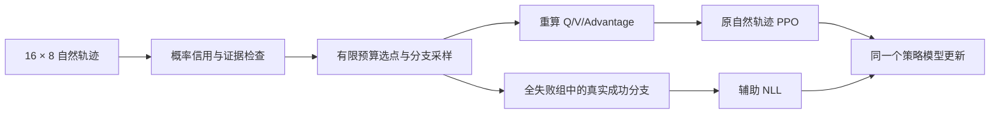

# IRGO

> **后续实验分支**：新增固定任务划分与P/N/R/F/F6对照入口，当前优先F6（6条自然＋原干预），尚未运行新150轮。下文81.25%是历史版本结果；历史实现固定在`eefaf39`。新协议、完整成本审计和运行说明见[实验说明](docs/experiments/RUNNING.md)。

**面向智能体强化学习的预算受限采样干预、概率信用更新与成功分支学习。**

本仓库整理了已完成 **150 轮训练**的 IRGO 实现，基于 GraphGPO / verl-agent / verl。当前验证环境是 **WebShop 的 1000 商品版本**，模型为 **Qwen2.5-1.5B-Instruct**。IRGO 是既有方法名称，本仓库暂不扩写未经确认的英文全称。

> 发布范围：算法源码、可配置训练/验证入口、方法注释、CPU 回归测试及汇总结果。模型权重、商品数据、完整实验轨迹和账号凭据不包含在 Git 仓库中。当前结果来自一个训练种子、三个验证环境种子；等成本消融与跨训练种子验证尚待补充。

## 1. 方法概览

每轮训练执行以下流程：

1. 同一个策略模型对 **16 个任务各自然采样 8 条轨迹**。
2. 按 **任务 + 完整页面观测文本**合并信用节点，估计有限视野的 `Q / V / Advantage`。
3. 用条件优势符号稳定性、证据覆盖及 WebShop 可检查的失败迹象选择干预位置。
4. 恢复原任务前缀，替换一个候选动作，再由当前策略自然执行后续步骤。**每任务最多 4 条，全轮最多 32 条，额外物理环境步最多 480**。
5. 将新证据纳入信用计算，更新原始自然轨迹的步骤优势，再交给原有 GraphGPO 优势合成和 PPO 更新。
6. 对本轮原始全失败、但干预找到真实成功分支的任务，增加成功分支辅助 NLL；与 PPO 使用**同一个模型和已有优化器**。



关键边界：

- **信用合并与现场恢复不同**：信用节点按任务/页面聚合；恢复分支必须核对完整输入 token 和剩余步数。
- **强制动作有明确来源**：可以提供转移证据；不计为自然动作频率，不混入普通 PPO 比率；成功分支可单独提供辅助学习标签。
- **第二次可信度检查不回退新优势**：即使证据仍少，有效新增证据仍参与重算。
- **512 次是后验参数抽样**，不是实际采样 512 条轨迹；95% 是条件稳定性代理，不是正确动作的保证。
- **历史轨迹只做影子审计**，不进入当前策略的信用估计或损失。
- WebShop 选点读取训练环境内部的目标与评分分解；这不是仅凭可见文本的通用进展判断。

详细公式、源码位置与数据边界见 [方法说明](docs/irgo/METHOD.md)。

## 2. 已完成的独立验证

第 150 轮模型；`text_rich`；每个环境种子 512 次任务；每次只执行一条轨迹；最多 30 步；温度 0.4。验证时不启用干预、不训练。

| 环境种子 | GraphGPO | 纯 Prob | 上一版 Prob+U | IRGO |
|---|---:|---:|---:|---:|
| 123 | 76.56% | 78.91% | 75.00% | **83.01%** |
| 456 | 73.63% | 75.98% | 70.51% | **80.86%** |
| 789 | 73.83% | 74.41% | 73.24% | **79.88%** |
| 总体 | 74.67% | 76.43% | 72.92% | **81.25%** |
| 成功次数 | 1147/1536 | 1174/1536 | 1120/1536 | **1248/1536** |

历史基线使用此前相同协议的已核验结果，本次只重新验证 IRGO。任务实例可能重复目标；环境种子不代表三个独立训练种子。结果支持整个训练方案的效用，尚不能把增益单独归因于选点或排除额外采样成本的影响。当前实验不是完整商品库的 WebShop 成绩。

原始次数、各次 W&B 链接与协议：[results/webshop_150.json](results/webshop_150.json)。训练内 128 次验证的 82.81% 与这里的 81.25% 是不同评测，不混用。

## 3. 代码结构

```text
configs/irgo/              可迁移的150轮配置、历史独立验证参数
scripts/irgo/              数据准备、训练启动、独立验证
recipe/GraphGPO/           IRGO算法与已验证的训练器集成
  prob_u.py               信用估计、稳定性代理、控制器、历史审计
  full_intervention.py    候选位置、预算、分支停止规则
  prob_u_runtime.py      token记录、精确回放、训练批次接入
  full_runtime.py        搜索提议、成功分支标签、审计数据压缩
  success_branch_loss.py  辅助批次与同模型反向传播
  probabilistic_credit.py 转移概率及有限视野策略评估
agent_system/             环境与记忆层；包含WebShop分支恢复
verl/                     基础训练框架及IRGO梯度接入
tests/irgo/               CPU算法与发布回归测试
reproducibility/          来源哈希、算法语法树指纹、参考依赖记录
docs/irgo/                方法、运行与验证说明
```

为保持已验证的导入路径，内部继续使用 `recipe.GraphGPO` 和 `prob_u` 名称；它们不表示还在运行上一版 Prob+U。不要仅依据文件名判断版本。源码与归档的对应关系见 [发布说明](docs/irgo/REPRODUCIBILITY.md)。

## 4. 安装

参考平台：Linux、Python 3.10、两张 A100 40GB、CUDA 12 系列、Java 11；需要足够主机内存和磁盘保存 FSDP 检查点与审计数据。历史运行使用约 64GB 主机内存。Mac/CPU 可执行单元测试，不能承担此 GPU 训练配置。

优先使用已有兼容训练环境：

```bash
git clone https://github.com/wuyi510627-droid/IRGO.git
cd IRGO
python -m pip install --no-deps -e .
```

新环境的参考安装顺序如下。CUDA 驱动、PyTorch、vLLM、FlashAttention 必须相互兼容；这不是在任意机器上已验证的锁定环境。

```bash
python3.10 -m venv .venv
source .venv/bin/activate
python -m pip install --upgrade pip
python -m pip install 'torch==2.6.0' 'vllm==0.8.5.post1' 'tensordict==0.6.2'
python -m pip install 'flash-attn==2.7.4.post1' --no-build-isolation
python -m pip install -r requirements/irgo.txt
python -m pip install --no-deps -e .
python -m spacy download en_core_web_sm
```

另外安装 Java 11 并设置 `JAVA_HOME`。参考来源环境的版本清单保存在 [reference_dependencies.json](reproducibility/reference_dependencies.json)，它不是此次重新导出的完整服务器环境锁文件。先运行两轮 smoke 验证，再运行完整训练。

## 5. 准备数据与初始模型

商品文件来自上游 WebShop，不随仓库发布。下载与索引构建需明确执行：

```bash
python scripts/irgo/prepare_webshop.py --download --build-index
python scripts/irgo/prepare_data.py --output data/text --train-rows 16 --val-rows 128
```

第二条命令生成文本模态的占位元数据；真实购物目标由环境给出，不需要下载 Geometry3k。元数据行数不是商品数，也不是固定的唯一任务清单。若要逐项复现历史运行，应使用归档 parquet 并核对哈希，而不是声称新生成文件逐字节相同。

准备本地 `Qwen/Qwen2.5-1.5B-Instruct` 初始模型目录。历史模型 revision 是 `989aa7980e4cf806f80c7fef2b1adb7bc71aa306`，单文件 `model.safetensors` 的 SHA256 为：

```text
dd924a11b4c220f385b51ffa522daea7c9f3d850e31b162bb5661df483c6d3ee
```

完整训练入口默认要求相同初始权重；其他初始模型必须显式加 `--allow-different-model`，其结果按新实验记录。

## 6. 训练

所有命令从仓库根目录执行。启动器默认只显示计划，**添加 `--execute` 才运行**。输出目录必须是新目录。

```bash
# 两轮端到端检查：独立输出，检查完成后完整训练重新从初始模型开始。
CUDA_VISIBLE_DEVICES=0,1 python scripts/irgo/train.py \
  --profile smoke --model /path/to/base_model \
  --data-dir data/text --output runs/smoke_001 --execute

# 已验证方案的150轮设置。
CUDA_VISIBLE_DEVICES=0,1 python scripts/irgo/train.py \
  --model /path/to/base_model --data-dir data/text \
  --output runs/irgo_150_seed0 --execute
```

关键设置见 [full150.yaml](configs/irgo/full150.yaml)：

| 项目 | 设置 |
|---|---|
| 训练轮数 / 自然采样 | 150 / 每轮16任务×8轨迹 |
| 环境 / 商品 / 观测 | WebShop / 1000 / `text_rich` |
| 训练步数上限 / 历史窗口 | 15 / 最近2步 |
| 输入 / 输出长度上限 | 5120 / 512 token |
| 参数更新 / 学习率 | 全参数 / `1e-6` |
| PPO每卡 microbatch | 1 |
| 概率信用视野 | 8 |
| 可信度抽样 / 阈值 / 最少动作出现次数 | 512 / 0.95 / 2 |
| 干预预算 | 全轮32条、每任务4条、含前缀共480环境步上限 |
| 辅助NLL系数 / 响应步骤混合 | 0.1 / 6普通成功 : 1关键响应 : 1自然后续 |
| 历史轨迹用途 | 最近10轮、最多1280条，仅影子审计 |
| 训练内验证 / 保存 | 每5轮；默认只保留最近1个actor检查点 |

150 轮是150次采样—信用计算—训练流程，不是仅150个底层优化器步。若需要保留中间模型，请在新实验开始前调整检查点保留配置并记录差异。

### W&B

默认离线记录，账号信息不写入配置文件。使用已登录账号在线记录：

```bash
wandb login
export WANDB_MODE=online
export WANDB_ENTITY=your_account_or_team
# 然后运行上面的训练命令；默认项目名为 IRGO。
```

记录内容包括任务/状态覆盖、分支数量、环境步与生成token、优势前后变化、全失败救回数量、辅助学习和历史审计。说明见 [运行与日志](docs/irgo/RUNNING.md)。

## 7. 导出与独立验证

训练器保留 FSDP 分片，需要导出为 Hugging Face 格式：

```bash
python scripts/model_merger.py merge --backend fsdp \
  --local_dir runs/irgo_150_seed0/run/global_step_150/actor \
  --target_dir exports/irgo_step150

CUDA_VISIBLE_DEVICES=0,1 python scripts/irgo/evaluate.py \
  --model exports/irgo_step150 --output runs/eval_step150 --execute
```

验证入口串行执行环境种子 `123、456、789`，每个512次任务，四批各128。每个种子完成就写入 `results.json`；全部完成后才标记 `complete=true`。脚本检查退出码、四批完成标记、全精度成功率与权重哈希。

导出后请核对来源、分片完整性和导出权重；仅存在一个 HF 目录不能证明导出模型正确。当前发布不包含历史模型权重。验证配置与训练内验证不同：独立验证最多30步、输入4096 token、左截断；以 [evaluation_overrides.json](configs/irgo/evaluation_overrides.json) 为准。

## 8. 检查与测试

```bash
python -m pip install -r requirements/test.txt
python -m pytest tests/irgo -q
python -m compileall -q recipe/GraphGPO scripts/irgo
```

测试覆盖：页面状态合并、强制/自然证据隔离、低覆盖证据保留、干预预算及成功停止、成功分支梯度、配置可迁移性、验证禁止训练、结果统计，以及20个归档算法文件的语法树一致性。

历史版本已经过两卡训练与验证；本次代码整理新增的启动器通过 CPU 配置和回归检查，**未声称重新完成一次 GPU 端到端训练**。详细检查边界见 [复现说明](docs/irgo/REPRODUCIBILITY.md)。

## 9. 致谢与许可

IRGO 基于 [GraphGPO / verl-agent](https://github.com/langfengQ/verl-agent)、[verl](https://github.com/volcengine/verl) 和 [WebShop](https://github.com/princeton-nlp/WebShop)。保留上游源码版权、[Apache-2.0 LICENSE](LICENSE)、[Notice.txt](Notice.txt) 与各子目录第三方许可，包括 [WebShop MIT License](agent_system/environments/env_package/webshop/webshop/LICENSE.md)。未将上游框架、数据集或图信用基础方法视为本项目原创。

本项目论文尚在准备中，当前不提供虚构的论文链接或 BibTeX。
